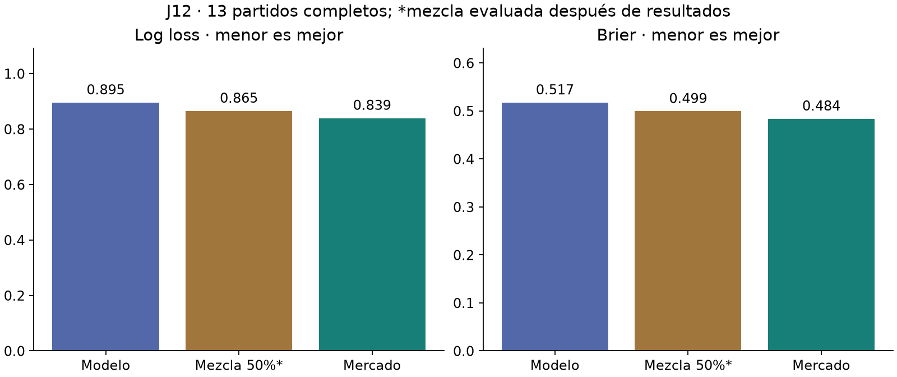
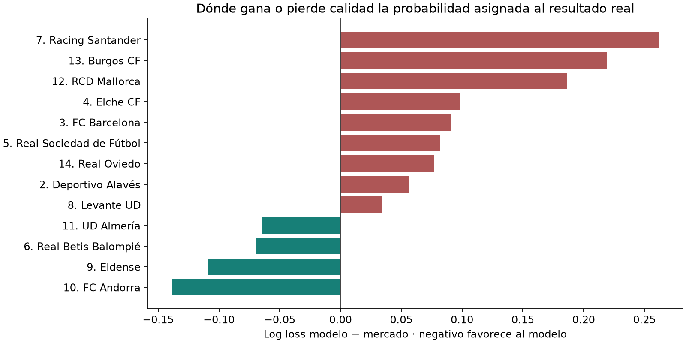

# Análisis de la jornada 12 · 14 de octubre de 2026

## 1. Resultado económico y aciertos

La estrategia principal guardada antes del cierre alcanzó **9 aciertos como máximo**.
Sus seis columnas fueron **8, 8, 9, 7, 9 y 7**. Coste de simulación: **4,50 €**;
retorno **0 €**, neto **−4,50 €**, ROI simulado condicionado **−100 %**.
Dos fuentes independientes coinciden en los quince signos y los seis premios.
La consulta directa al artículo SELAE fue restringida por geografía; se mantiene
pendiente la verificación primaria y no se ha escrito una liquidación oficial.

| Estrategia guardada | Aciertos de cada columna | Máximo | Retorno | Neto |
| --- | --- | ---: | ---: | ---: |
| Doble + triple | 8, 7, 7, 8, 7, 7 | 8 | 0.00 € | -4.50 € |
| Seis columnas · principal | 8, 8, 9, 7, 9, 7 | 9 | 0.00 € | -4.50 € |
| Sistema robusto | 9, 8, 10, 9, 9, 8 | 10 | 0.00 € | -4.50 € |
| Columnas robustas | 8, 9, 8, 7, 8, 7 | 9 | 0.00 € | -4.50 € |
| Sistema para ≥10 | 8, 7, 7, 8, 7, 7 | 8 | 0.00 € | -4.50 € |

**El sistema robusto llegó a diez y tampoco cobró**: el premio de diez fue
0 €. Once aciertos pagaron 3,91 €; una sola columna con once habría dejado
un neto de **−0,59 €** sobre los 4,50 €. P(≥10), cobrar y obtener beneficio
no son el mismo objetivo. Estos premios se conocen después de la jornada,
por lo que no sirven como pronóstico de rentabilidad previo al cierre.

Pleno propuesto **M–1**; resultado publicado **1–0**. El modelo asignaba
15,34 % a M–1 y 6,84 % a 1–0. Un único marcador no permite calibrar el Pleno.

## 2. Probabilidades: modelo frente al mercado

Se evalúan **13 partidos completos**. Rayo–Athletic figura como `Abandoned`
en LaLiga: su 0–0 no se añade al entrenamiento ni se puntúa como empate
deportivo. Se mantiene el signo X del resumen de Quiniela para el recuento
económico condicionado. La Liga F no intervino en este boleto.

| Pronóstico | Log loss ↓ | Brier ↓ | Acierto del favorito |
| --- | ---: | ---: | ---: |
| Modelo | 0.8951 | 0.5172 | 61.5% |
| Mezcla 50%* | 0.8651 | 0.4991 | 61.5% |
| Mercado | 0.8394 | 0.4836 | 61.5% |

*La mezcla 50 % es un diagnóstico retrospectivo de entradas que ya existían
antes del cierre; no se presentó ni se registró como apuesta original.*



En los **24 partidos únicos** del estudio de cuotas acumulado, la diferencia
media de log loss modelo−mercado es **0.0482**.
Positivo indica peor resultado del modelo. El intervalo descriptivo de bootstrap
por partido es **[0.0014, 0.0926]**. Solo hay dos fines de semana:
no es una prueba sólida de ventaja ni de inferioridad estable. El mercado
ha funcionado mejor en log loss y Brier en la muestra observada; eso justifica
evaluarlo como parte de un candidato, no afirmar un ROI positivo.



## 3. Partido a partido

Las probabilidades son las asignadas al resultado finalmente observado, no
probabilidades recalculadas después. Rayo se excluye del análisis deportivo.

| Nº | Partido | Resultado | P real · modelo | P real · mercado | Cubierto por alguna columna principal |
| --- | --- | --- | ---: | ---: | --- |
| 1 | Rayo Vallecano de Madrid–Athletic Club | Interrumpido; signo X | Excluido | Excluido | No |
| 2 | Deportivo Alavés–Club Atlético de Madrid | 1-2 (2) | 49.3% | 52.1% | Sí |
| 3 | FC Barcelona–Getafe CF | 3-0 (1) | 82.2% | 90.0% | Sí |
| 4 | Elche CF–RC Celta de Vigo | 0-0 (X) | 26.6% | 29.3% | No |
| 5 | Real Sociedad de Fútbol–Deportivo La Coruña | 3-2 (1) | 52.1% | 56.6% | Sí |
| 6 | Real Betis Balompié–CA Osasuna | 5-2 (1) | 63.7% | 59.4% | Sí |
| 7 | Racing Santander–Valencia CF | 2-2 (X) | 20.6% | 26.8% | No |
| 8 | Levante UD–Sevilla FC | 3-3 (X) | 27.9% | 28.9% | No |
| 9 | Eldense–Córdoba CF | 2-1 (1) | 43.5% | 39.0% | Sí |
| 10 | FC Andorra–CD Castellón | 1-0 (1) | 35.3% | 30.7% | Sí |
| 11 | UD Almería–CD Leganés | 3-0 (1) | 60.4% | 56.7% | Sí |
| 12 | RCD Mallorca–UD Las Palmas | 3-1 (1) | 48.9% | 58.9% | Sí |
| 13 | Burgos CF–Granada CF | 0-1 (2) | 24.6% | 30.7% | No |
| 14 | Real Oviedo–SD Eibar | 3-1 (1) | 38.5% | 41.6% | Sí |

Los mayores costes de log loss frente al mercado están en Racing–Valencia,
Burgos–Granada y Mallorca–Las Palmas. En Racing la X recibió **20,62 %**
del modelo y **26,80 %** del mercado. Burgos–Granada terminó en 2: el modelo
le asignaba **24,61 %**, frente a **30,65 %**. En Mallorca la victoria local
tenía **48,93 %**, frente a **58,94 %**. También hay encuentros donde el
modelo fue mejor: Andorra, Eldense, Betis y Almería. La discrepancia debe
medirse con probabilidades completas, no solo con el favorito acertado.

## 4. Dobles, triples y concentración de las columnas

Las seis columnas principales compartían **11 signos de 14**. Solo variaban
Elche–Celta, Andorra–Castellón y Oviedo–Eibar. Cuatro signos compartidos
fallaron: Rayo, Racing, Levante y Burgos. Además, ninguna columna llevaba
la X de Elche. Por eso el máximo quedó en nueve.

La concentración es consecuencia de maximizar P(14) con seis columnas;
no es por sí sola un error del optimizador. El cálculo ya considera la
dependencia entre columnas por compartir resultados. La P(≥10) prevista
era **18,55 %**: una jornada sin diez tenía **81,45 %** de probabilidad
bajo el propio modelo. El resultado económico desfavorable no demuestra
por sí solo que el algoritmo de asignación falle.

La alternativa robusta puso triple en Elche y doble en Andorra; alcanzó
diez. No debe pasar a estrategia principal solo por ganar esta comparación
de una jornada. En `analysis.json` quedan comparados también boletos de mercado,
mezcla fija y sistemas para ≥11, todos marcados como retrospectivos.


### No hay fundamento para subir todas las X

En los trece partidos completos, el modelo asignaba en promedio **24,46 %**
al empate y hubo **23,08 %** de empates. Que las columnas no llevaran muchas X
no demuestra una infravaloración global del empate: el signo más probable
de un partido puede ser 1 aun con una X relevante. Los errores de Racing y
Elche requieren estudiar contexto y probabilidades locales; subir la X a todos
los encuentros después de esta jornada sería una corrección sin validar.

### Presupuesto y composición

Con 5 € y 0,75 € por columna caben un doble (1,50 €), un triple (2,25 €),
dos dobles (3 €), o un doble y un triple (4,50 €). Tres dobles cuestan 6 €
y dos triples 6,75 €, por encima del presupuesto. Seis columnas individuales
permiten combinaciones distintas de un sistema completo. El número y ubicación
de dobles/triples debe elegirse por la función objetivo declarada; la varianza
del estimador por sí sola no indica qué signos conviene cubrir.

Con los premios observados de J12, dos columnas con once darían 7,82 €,
neto +3,32 €; una sola con once daría neto −0,59 €. Por tanto, la probabilidad
de beneficio exige contar conjuntamente las columnas premiadas. Maximizar solo
el máximo número de aciertos no resuelve ese problema.

## 5. Limitaciones concretas detectadas

1. **El mercado solo se mostraba como comparación**; sus probabilidades no
   influían en la propuesta. Es la primera variable externa que ya tenemos
   con fecha y procedencia anteriores a los partidos.
2. **Pronóstico temprano**: el corte fue 05-10, con datos hasta el 04-10,
   y las cuotas del 05-10. Hasta el cierre del 10-10 transcurrieron casi
   cinco días. Córdoba jugó el 05-10 y ese resultado no estaba en el modelo
   al preparar J12. No hay cuotas de cierre guardadas y no se pueden inventar.
3. **Ascensos e historial corto**: las posiciones 5, 7, 9, 12, 14
   tienen al menos un equipo con menos de diez partidos recientes en esa
   división. Deportivo, Racing, Eldense, Mallorca y Oviedo necesitan una
   evaluación específica de transferencia de fuerza y reducción de confianza.
   El modelo de goles principal se ajusta por división; las variables de forma
   transfieren parte de la historia, pero la mezcla sigue dando gran peso
   al componente de goles con poca información de la nueva división.
4. **Incertidumbre parcial**: el consenso de mercado sale de alguna banda
   5–95 % del bootstrap del modelo en **7 partidos**. El mercado
   no es la verdad, pero las bandas no representan toda la incertidumbre:
   omiten disponibilidad de jugadores, estructura del modelo y error de cuotas.
5. **Objetivo económico incompleto**: faltan porcentajes del público y su
   dependencia entre signos, recaudación/bote antes del cierre y un modelo
   validado de premios. Las cuotas de casas de apuestas no sustituyen a los
   porcentajes jugados en La Quiniela.
6. **Evaluación administrativa**: los evaluadores antiguos dejaban Rayo como
   pendiente. Ahora lo registran como exclusión deportiva con fuente y hash;
   sigue contando en el recuento de Quiniela si se confirma su signo oficial.

## 6. Cambios y experimentos, por orden

### Prioridad 1: candidato que incorpore cuotas

Preparar una mezcla fija **50 % modelo + 50 % mercado**, comparada con el
modelo congelado y mercado puro. El peso es una elección inicial conservadora,
no el mejor peso seleccionado con estos resultados. No ajustar temperatura,
sesgos o peso con esta pequeña muestra. Nuevo protocolo y cohorte futura;
registrar cada versión antes del cierre y no sustituir registros anteriores.
Liga F conserva el modelo propio mientras falten cuotas válidas.

### Prioridad 2: mejorar el momento y la calidad de los datos

Generar la decisión final cerca del cierre, conservando el margen para validar
el boleto y antes de todos sus inicios. Incorporar únicamente resultados
finalizados conocidos antes del corte. Capturar cuotas de decisión y una
segunda captura cercana al cierre para analizar cambios de mercado. Guardar
para cada variable fecha del hecho y fecha de disponibilidad.

### Prioridad 3: objetivos de cartera más útiles

Comparar P(14), P(≥11), probabilidad de cobrar, recuperar el coste y beneficio
esperado. P(≥11) sigue siendo un indicador de aciertos, no de rentabilidad.
Cuando existan datos del público, valorar cada columna por el premio esperado
por categoría y su popularidad; hasta entonces mantener cobertura como objetivo
explícito y la simulación económica como evaluación posterior.

### Prioridad 4: transferencia y calendario

Evaluar en temporadas históricas separadas un modelo jerárquico de fuerza
entre Primera/Segunda para ascensos, con priors de goles ajustados por categoría.
Añadir calendario completo de clubes (Liga, Copa y competición europea) para
descanso real y carga reciente. Los descansos actuales solo ven las ligas del
dataset. Añadir bajas y alineaciones únicamente con fuente autorizada y hora
de publicación; no reconstruir lesiones conocidas después como si fueran previas.

### Prioridad 5: calibración y nuevos modelos

Con suficientes predicciones nuevas, estudiar calibración por competición y
resultado en ventanas temporales, con regularización. Probar corrección residual
del mercado con un modelo sencillo antes de añadir otra red neuronal. Goles,
forma y Elo ya están incorporados; añadir columnas duplicadas o complejidad
sin una comparación temporal independiente no demuestra mejora.

## 7. Trabajo ejecutado y pendiente

- Nuevo histórico: **10.993 resultados**, +21 (9 Primera y 12 Segunda).
  Rayo interrumpido queda fuera; Liga F sigue hasta el 04-10 y su siguiente
  jornada capturada aún no había comenzado.
- Evaluación de 27 partidos de boletos: 14 de J11 y 13 de J12, con una exclusión
  deportiva auditada y sin pendientes deportivos sin clasificar.
- Evaluación de cuotas en 24 partidos únicos; se conserva la primera predicción
  y no se duplica un encuentro por aparecer en dos capturas.
- Revisión final deportiva de J11: disponible en `j11_complete/dashboard.html`.
  Su Pleno de selecciones sigue fuera de la cohorte económica.
- Predicciones, configuraciones de modelos y sellos anteriores preservados.
- Liquidación primaria de J12 pendiente de acceso o extracto oficial; todas
  las cifras de retorno aquí están expresamente marcadas como simulación
  condicionada a las dos fuentes independientes concordantes.

No hay evidencia de ROI esperado positivo. El cambio con más fundamento ahora
es incorporar el mercado y reducir la antigüedad de los datos; las mejoras deben
ganarse su lugar en jornadas nuevas, no escogerse por cómo habrían acertado esta.

## Fuentes y reproducibilidad

- [LaLiga Primera, jornada 8](https://www.laliga.com/laliga-easports/resultados/2026-27/jornada-8)
- [LaLiga Segunda, jornada 9](https://www.laliga.com/laliga-hypermotion/resultados/2026-27/jornada-9)
- [Resumen independiente de J12](https://www.quinielafutbol.info/resultados/jornada-quiniela-domingo-11-de-octubre-de-2026.html)
- [Segunda comprobación del escrutinio](https://comprobarloteria.com/quiniela/2026-10-11/)
- [Documentación de calibración de scikit-learn](https://scikit-learn.org/stable/modules/calibration.html)

`analysis.json` guarda probabilidades, aciertos, métricas, límites, procedencia
y comparaciones retrospectivas. `probability_evaluation.json` y
`market_evaluation.json` incluyen todas las observaciones elegibles. Los datos
capturados y sus hashes se conservan en `data/raw/results_20261014`.

## 8. Candidato y comandos preparados

Se implementó `market.pooling.pool_probabilities` y el CLI
`scripts/plan_market_pool.py`. Su configuración y protocolo están declarados
en `configs/market_pool50_20261014.json` y
`configs/market_pool50_protocol_20261014.json`. La cohorte empieza **15-10-2026**;
J11/J12 solo motivan el experimento y no cuentan como validación del candidato.
El peso 50 % queda fijo. La comparación tiene como referencias el modelo
actual y mercado puro, con métricas por competición.

Para una futura jornada verificada, generar primero una nueva previsión base
con el candidato actual y su archivo de escenarios, con resultados disponibles
antes del corte. Capturar cuotas contemporáneas y observar el boleto/cierre.
Entonces se puede ejecutar (las rutas FUTURO son marcadores, no datos inventados):

```powershell
python scripts/plan_market_pool.py --base-forecast outputs/predictions/FUTURO_base/forecast.json --scenarios outputs/predictions/FUTURO_base/scenarios.npz --snapshot data/raw/FUTURO_mercado/snapshot.json --official-observation data/raw/FUTURO_boleto/official_observation.json --config configs/market_pool50_20261014.json --output-dir outputs/predictions/FUTURO_pool50
python scripts/probability_registry.py register --candidate outputs/predictions/FUTURO_pool50/forecast.json --comparator outputs/predictions/FUTURO_base/forecast.json --observation data/raw/FUTURO_boleto/official_observation.json --protocol configs/market_pool50_protocol_20261014.json --root outputs/predictions/probability_pairs_pool50
```

El CLI exige previsión base posterior a la declaración y de menos de 48 horas,
el mismo modelo base congelado, cuotas válidas para todos los partidos masculinos,
observación real confirmada y ejecución antes del cierre y de todos los inicios.
Liga F permanece en el modelo base mientras falten cuotas válidas. Las bandas
del candidato miden solo sensibilidad del modelo base con el mercado fijo:
**no incluyen incertidumbre del mercado ni son intervalos de confianza calibrados**.
El Pleno sigue en el modelo de goles base. La generación por sí sola no registra
ni compra un boleto; el registro del par es un paso explícito posterior.

Para reevaluar los originales y separar partidos interrumpidos:

```powershell
python scripts/probability_registry.py evaluate --dataset data/processed/matches_quiniela_20261014.parquet --sporting-snapshots data/raw/results_20261014 --output outputs/reports/NUEVA_REVISION/probability_evaluation.json
python scripts/evaluate_market_studies.py --root outputs/predictions/market_matches --dataset data/processed/matches_quiniela_20261014.parquet --sporting-snapshots data/raw/results_20261014 --output outputs/reports/NUEVA_REVISION/market_evaluation.json
```

Se ejecutaron actualización, evaluaciones, cálculos retrospectivos y generación
del informe; se revisaron sintaxis y lint. El nuevo CLI futuro se comprobó con
su ayuda y revisión de código, pero **no se ejecutó una predicción futura con él**:
todavía no se han aportado sus entradas contemporáneas de una nueva jornada.
No se añadieron ni ejecutaron tests unitarios.
